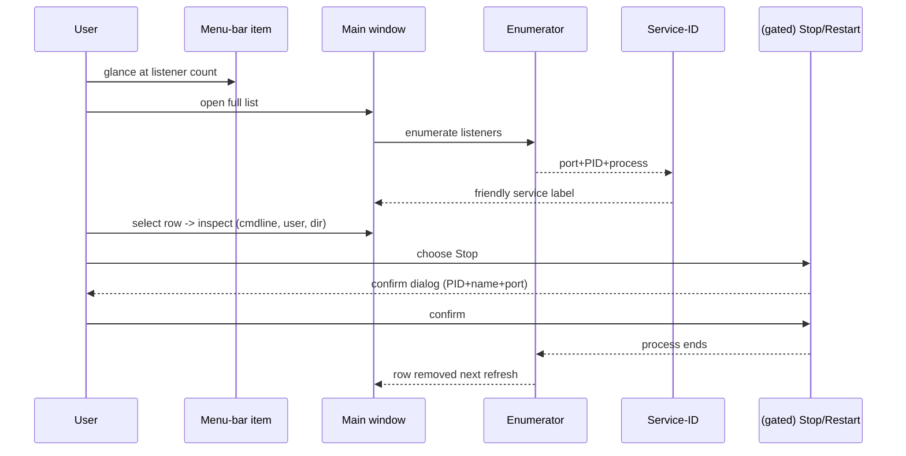

# Stage 2 — Requirements Brief: Ports On

## Inputs

- Shared context: `.planning/_shared-context.md` (verified env facts + researched macOS enumeration/privilege grounding).
- Product owner intent: native macOS Tahoe (26.x) app that shows active local network ports, the process/service owning each, and allows security-gated stop/restart.
- Host facts I may rely on (already verified, not re-checked here): `lsof`, `netstat`, `launchctl`, `sysctl`, `libproc`/`proc_pidinfo` exist; there is no `ss`; no `/proc` on macOS; App Sandbox + Hardened Runtime + notarization constraints apply; `SMAppService` is the modern privileged-helper path; `NWPathMonitor` cannot enumerate listeners.
- Scope of this stage: requirements only. No architecture choice, no DB/hosting pick, no code, no Xcode project.

## Completion condition

A single numbered requirement set (FR/NFR, unique IDs, priorities, sources, status, acceptance criteria) that the architect can hand to design/implementation without re-deriving scope, and that flags every open product decision the owner must settle before v1 freezes.

---

## 1. Problem, goals, users

**Problem.** On macOS there is no first-class, always-visible view of "what is listening on my machine right now and which app/service owns it." Developers and power users fall back to `lsof`/`netstat` in a terminal, which is per-invocation, unfiltered, and gives no friendly service name or a safe way to stop the offending process.

**Goals (confirmed).**
- G-1: Make the active port→process→service mapping on the local Mac legible at a glance, continuously.
- G-2: Let a user identify unfamiliar listeners (a dev server, a container, a background agent) without leaving the UI.
- G-3: Let a user safely stop or restart a process that is holding a port, with appropriate confirmation and privilege handling.

**Primary users (confirmed).** Single-user local developers and technical power users running services locally (web servers, containers, AI agents like `opencode`/`omp`, JS frameworks like `nextjs`/`astro`, `nodejs`, `nginx`, `docker`). Multi-user/server-admin scenarios are out of scope for v1 (see OQ-1, OQ-4).

**Expected value.** Faster diagnosis of "port already in use" errors and rogue listeners; a safe alternative to hand-typing `kill`/`lsof`.

---

## 2. Scope

**In scope (v1).**
- Enumerating listening TCP sockets and (per OQ-3, tentatively) UDP endpoints on the local machine with owning PID/process.
- Mapping port/process to a known friendly service name (known-port table + process-name fingerprint + user overrides).
- Live/refreshing view; inspect detail (command line, working dir, user, protocol, address).
- Stop/restart for processes the current user owns, gated behind explicit confirmation.
- Menu-bar presence plus a main window.
- Local-only persistence of user overrides and preferences.

**Out of scope (v1).**
- Remote hosts, network scanning beyond the local machine, and any backend/database service.
- Deep packet inspection, bandwidth/traffic accounting, or connection content.
- Firewall rule editing or `pf` management.
- Editing of other users' processes without elevation (see OQ-1).
- Any GUI for managing the privileged helper's lifecycle beyond install/authorize prompts.

---

## 3. Functional requirements

Priorities: **MUST** (v1 blocking), **SHOULD** (strongly desired, may slip), **COULD** (nice-to-have). Status is `confirmed` (owner-stated or directly implied), `assumed` (derived, needs confirmation), or `needs-clarification` (tracked as an Open Question).

### 3.1 Core enumeration

- **FR-001 (MUST, confirmed, security-sensitive)** — The app MUST list all currently listening TCP sockets on the local machine, each row showing at minimum: local address, TCP port, and the owning process. Source: G-1, product intent.
  - *Acceptance:* With a known service listening (e.g. start a local HTTP server on a chosen port), the port and owning process appear in the list within one refresh cycle; stopping that service removes the row on the next refresh.

- **FR-002 (SHOULD, assumed, security-sensitive)** — The app SHOULD also enumerate active UDP endpoints (bound/local port + owning process) alongside TCP. UDP has no "LISTEN" state, so these are presented as bound endpoints. Tracked as OQ-3.
  - *Acceptance:* A process holding a UDP port (e.g. a DNS or mDNS responder) appears with its UDP port and PID.

- **FR-003 (MUST, confirmed)** — Each enumerated socket row MUST resolve to the owning PID and process name. Source: G-1.
  - *Acceptance:* Two different processes listening on two ports show two distinct PID/process pairs; no row shows an empty owner for a socket the user's own processes hold.

- **FR-004 (MUST, confirmed)** — The app MUST present, per row, the protocol (TCP/UDP) and the bound address (IPv4/IPv6, wildcard `0.0.0.0`/`::` vs loopback `127.0.0.1`/`::1` vs a specific interface address). Source: shared-context grounding on `lsof`/`netstat` fields.
  - *Acceptance:* A wildcard listener and a loopback-only listener are visually distinguishable.

- **FR-005 (MUST, assumed)** — Enumeration MUST cover sockets owned by processes running as the current user by default. Visibility of *other users'* and *root* processes is privilege-gated and tracked as FR-020/OQ-1/OQ-5.
  - *Acceptance:* Without any elevation, all listeners owned by the logged-in user appear.

### 3.2 Service identification

- **FR-006 (MUST, confirmed)** — The app MUST map a port/process to a friendly service label using a built-in known-port + known-process table covering at least the services named by the owner: `nginx`, `docker`, `nodejs`, `nextjs`, `astro`, `opencode`, `omp`. Source: product intent.
  - *Acceptance:* Each named service, when running and listening, displays its friendly name (and a recognizable glyph) rather than a raw binary name.

- **FR-007 (MUST, confirmed)** — Identification MUST use three inputs in priority order: (1) user-defined override, (2) process-name / binary fingerprint, (3) well-known port number. Override always wins. Source: product intent.
  - *Acceptance:* A user override on a port changes the displayed label immediately and survives relaunch (see FR-025); removing the override falls back to fingerprint, then known-port.

- **FR-008 (SHOULD, confirmed)** — When no override, fingerprint, or known-port match applies, the app MUST show the raw process name and mark the service as "unknown/custom" rather than guessing a label. Source: honesty (no fabricated labels).
  - *Acceptance:* An obscure binary shows its real process name plus an explicit "unrecognized" affordance inviting the user to add an override.

- **FR-009 (SHOULD, assumed)** — The built-in known-service table SHOULD be data-driven (a local resource) so it can be updated without app-logic changes. Source: maintainability (six-month horizon).
  - *Acceptance:* Adding a new known service is a data/table change, not new Swift logic.

### 3.3 Live refresh / watch

- **FR-010 (MUST, confirmed)** — The list MUST refresh automatically so new and removed listeners are reflected without a manual action. Default interval is a preference (see FR-025). Source: G-1 "continuously."
  - *Acceptance:* Starting a listener makes it appear; stopping it makes it disappear, both without user input.

- **FR-011 (MUST, confirmed)** — The user MUST be able to trigger a manual refresh on demand. Source: standard control expectation.
  - *Acceptance:* A refresh control exists in both the main window and the menu-bar UI and re-runs enumeration immediately.

- **FR-012 (SHOULD, assumed)** — Rows that appeared or disappeared since the previous snapshot SHOULD be visually indicated (e.g. "new" highlight, brief fade-out) so changes are noticeable. Source: G-1 legibility.
  - *Acceptance:* A freshly started listener is distinguishable from a long-running one for at least one refresh cycle.

- **FR-013 (SHOULD, assumed)** — Refresh MUST be resilient: a failed or partially-failed enumeration shows the last good snapshot plus a non-blocking error indicator, never a blank/crashed list. Source: resilience / three-states rule.
  - *Acceptance:* Forcing an enumeration failure (e.g. revoking a permission) surfaces a visible error state while retaining prior data.

### 3.4 Inspect detail

- **FR-014 (MUST, confirmed, security-sensitive)** — Selecting a row MUST reveal process detail: full command line, the user the process runs as, and the protocol/address/port already in the list. Source: product intent; command line and other-user visibility are privilege-gated (OQ-5).
  - *Acceptance:* For a user-owned process, the full command line and owning username are shown.

- **FR-015 (SHOULD, confirmed, security-sensitive)** — Where obtainable without elevation, the detail view SHOULD also show the process working directory. Tracked with OQ-5 (may require Full Disk Access for other users).
  - *Acceptance:* For a user-owned process, the working directory is shown when the OS permits it; when not permitted, the field shows an explicit "requires permission" state rather than a blank.

- **FR-016 (SHOULD, assumed)** — The detail view SHOULD expose a way to copy the identifying fields (PID, port, command line) to the clipboard for pasting into a terminal. Source: developer-workflow value.
  - *Acceptance:* A copy affordance places the selected field(s) on the pasteboard.

### 3.5 Stop / restart action

- **FR-017 (MUST, confirmed, security-sensitive)** — The user MUST be able to stop (send a termination signal to) a process shown in the list, for processes the current user owns. Source: G-3.
  - *Acceptance:* Stopping a user-owned listener ends the process and the row clears on the next refresh.

- **FR-018 (MUST, confirmed, security-sensitive)** — Every stop/restart action MUST be gated behind an explicit confirmation naming the target process (PID + name + port). The confirmation MUST state the action is irreversible. Source: G-3 "security-gated."
  - *Acceptance:* No process can be terminated by a single accidental click/tap; the dialog names the exact process before proceeding.

- **FR-019 (SHOULD, confirmed, security-sensitive)** — The app SHOULD offer a "restart" affordance where a restart is meaningfully derivable (e.g. a launchd-managed service can be relaunched). When a clean restart is not derivable, the app MUST say so and offer stop only. Source: G-3, honesty about limits.
  - *Acceptance:* For a non-restartable process, the restart control is disabled or explains why, rather than pretending to restart.

- **FR-020 (SHOULD, needs-clarification, security-sensitive)** — Stopping/restarting processes owned by *other users* or *root* requires an elevated privileged helper (per shared-context: a process can generally signal only processes it owns; elevation needs a root helper via `SMAppService` + XPC). Whether this elevated path ships in **v1** is OQ-1. If deferred, the app MUST clearly indicate that other-user/root rows are view-only in v1.
  - *Acceptance (if in v1):* Authorizing the helper is a one-time user consent; after authorization, an other-user/root process can be stopped via the same gated confirmation. *Acceptance (if deferred):* Other-user/root rows render as view-only with an explanatory label.

### 3.6 Presentation (menu bar + main window)

- **FR-021 (MUST, confirmed)** — The app MUST run as a menu-bar (agent) presence showing a compact live summary (e.g. count of active listeners, and/or the most relevant port). Source: product intent "menu-bar."
  - *Acceptance:* The menu-bar item reflects current listener state within one refresh cycle without opening the main window.

- **FR-022 (MUST, confirmed)** — The app MUST provide a main window with the full sortable/filterable table of listeners. Source: G-1, G-2.
  - *Acceptance:* The main window opens from the menu-bar item and shows the complete enumeration with inspect detail on selection.

- **FR-023 (SHOULD, confirmed)** — The main window MUST support filtering/search (by port, process name, or service label) and column sorting. Source: usability for many-listener machines.
  - *Acceptance:* Typing a port or name narrows the list to matching rows; clicking a column header sorts by it.

- **FR-024 (COULD, assumed)** — The main window SHOULD offer a compact/expanded density view. Source: power-user preference.
  - *Acceptance:* Density toggle changes row height/visible columns without losing state.

### 3.7 Settings & persistence

- **FR-025 (MUST, confirmed)** — The app MUST persist, locally only, (a) user-defined service overrides (FR-007/FR-008) and (b) user preferences including refresh interval (FR-010) and presentation choices. Source: product intent "settings/persistence."
  - *Acceptance:* Overrides and preferences survive app relaunch and system reboot; nothing is sent off-device.

- **FR-026 (SHOULD, confirmed)** — Settings MUST be editable in-app (a settings surface reachable from the menu bar and main window). Source: product intent.
  - *Acceptance:* Changing the refresh interval takes effect without reinstall/restart of the helper.

- **FR-027 (SHOULD, assumed)** — The user MUST be able to add, edit, and delete service overrides and to reset overrides to defaults. Source: FR-007 override lifecycle.
  - *Acceptance:* Deleting an override reverts identification to fingerprint/known-port on the next refresh.

### 3.8 States & feedback

- **FR-028 (MUST, confirmed)** — Every data view MUST implement empty (no listeners), loading/refreshing, and error states. Source: three-states rule.
  - *Acceptance:* A machine with no listening sockets shows a clear empty state, not a blank table.

- **FR-029 (SHOULD, assumed)** — Stop/restart outcomes (success, failure, permission-denied) MUST surface clear feedback, including the OS error reason when a stop fails. Source: G-3 trust.
  - *Acceptance:* A denied stop shows why (e.g. needs elevation) rather than failing silently.

---

## 4. Non-functional requirements

- **NFR-001 (MUST, confirmed)** — **Native Tahoe/SwiftUI feel.** The UI MUST be built with SwiftUI and follow current macOS (Tahoe 26.x) design conventions (system materials, standard controls, keyboard/trackpad behavior) so it reads as a native citizen, not a web wrapper. Source: product intent "macOS Tahoe/SwiftUI native feel."
  - *Validation:* Review against a reference native macOS utility for control/material consistency.

- **NFR-002 (MUST, assumed, security-sensitive)** — **Least privilege.** Enumeration of the user's own processes MUST work without elevation. Elevation (privileged helper) is used only for cross-user/root stop (FR-020) and never requested for read-only user-owned enumeration. Source: shared-context privilege grounding.
  - *Validation:* A fresh install performs user-owned enumeration with no authorization prompt.

- **NFR-003 (MUST, assumed)** — **Refresh performance.** A full enumeration refresh SHOULD complete fast enough for a sub-second-to-few-second cadence without freezing the UI (enumeration off the main thread). Source: G-1 continuity; exact target is OQ-6.
  - *Validation:* UI stays responsive during a refresh on a machine with many listeners.

- **NFR-004 (SHOULD, assumed, security-sensitive)** — **Local-only / privacy.** All data stays on-device; no telemetry, no network egress of process/port data. Source: "local desktop tool, no backend" (shared context).
  - *Validation:* No outbound connections carrying process/port metadata.

- **NFR-005 (MUST, assumed)** — **Distribution readiness.** The app (and any helper) MUST be compatible with Hardened Runtime + notarization for Developer-ID distribution, and sandboxed per App Sandbox rules with any needed entitlements or a separated helper (shared context). Distribution channel itself is OQ-4.
  - *Validation:* Builds pass signing/notarization prerequisites; sandbox violations are resolved by entitlement or a helper, not by disabling sandbox.

- **NFR-006 (SHOULD, assumed)** — **Accessibility.** The UI SHOULD be operable via full keyboard navigation and VoiceOver, with visible focus states and meaningful labels. Source: macOS accessibility expectations.
  - *Validation:* Keyboard-only walkthrough of refresh, filter, select, and (gated) stop.

- **NFR-007 (SHOULD, assumed)** — **Robustness across macOS versions / private interfaces.** If the programmatic `sysctl`/`libproc` path (rather than `lsof`) is chosen, it uses semi-private kernel interfaces and MUST degrade gracefully (fall back to a subprocess enumeration) if structs/behavior differ from the targeted SDK. Tied to architecture; recorded here because it affects correctness guarantees. Source: shared-context enumeration grounding.
  - *Validation:* Enumeration returns a sane result or a clear error, never a crash, when the kernel interface mismatches.

- **NFR-008 (COULD, assumed)** — **Resource footprint.** Idle CPU/network cost of continuous refresh SHOULD be minimal (menu-bar agent stays quiet when idle). Source: always-running agent etiquette.
  - *Validation:* Negligible idle CPU when no change occurs between refreshes.

- **NFR-009 (SHOULD, assumed)** — **Maintainability.** The known-service table (FR-009), override storage (FR-025), and privilege boundaries (NFR-002) SHOULD be modular so future services and elevation changes don't require broad refactors. Source: six-month horizon.
  - *Validation:* Adding a service or toggling the helper-in-v1 decision touches a bounded set of files.

---

## 5. Key user journeys

**Journey A — "Port already in use."** Dev server fails to bind :3000. User opens Ports On, filters "3000", sees it's a stale `nodejs` process, inspects the command line to confirm, stops it via the gated action, restarts their server. (FR-001, FR-003, FR-006, FR-007, FR-014, FR-017, FR-018.)

**Journey B — "What is this listener?"** User notices an unfamiliar port. Filters, sees an unrecognized process, adds a user override to label it for next time. (FR-008, FR-027.)

**Journey C — "Rogue listener under another account."** User sees a root-owned row. If FR-020 is in v1, they authorize the helper once and stop it; if deferred, they see a view-only label explaining elevation is needed. (FR-020, OQ-1.)

---

## 6. Business rules & policy constraints

- **BR-001 (security-sensitive, confirmed).** A stop/restart MUST never occur without explicit, target-naming confirmation (FR-018).
- **BR-002 (security-sensitive, confirmed).** Elevation is only for mutating actions on processes the user does not own (FR-020, NFR-002). Read-only user-owned enumeration stays unprivileged.
- **BR-003 (confirmed).** User overrides take precedence over built-in identification, always (FR-007).
- **BR-004 (assumed).** Persistence is local-only; no cloud sync, no telemetry of port/process data (FR-025, NFR-004).
- **BR-005 (assumed).** The app must not present fabricated service labels or statistics; unknown services are labeled honestly (FR-008).

---

## 7. Dependencies & external integrations

- **D-001.** macOS system facilities for enumeration: `lsof`/`netstat` (subprocess path) or `sysctl` (`net.inet.tcp.pcblist`, `net.inet.udp.pcblist`) + `libproc` (`proc_pidinfo`) (programmatic path). Exact choice is an architecture decision, not fixed here (shared context).
- **D-002.** `SMAppService` (ServiceManagement) + XPC for any privileged helper (only if FR-020 is in v1).
- **D-003.** TCC / Full Disk Access (`SystemPolicyAllFiles`) may be required to read other users' command lines / working dirs (affects FR-014, FR-015, OQ-5).
- **D-004.** Signing/notarization toolchain for distribution (NFR-005, OQ-4).
- **D-005.** SwiftUI / AppKit for menu-bar + window presentation (FR-021, FR-022, NFR-001).

---

## 8. Assumptions & risks

- **A-001 (assumed).** v1 targets a single logged-in user managing their own processes; multi-user admin is not a v1 scenario.
- **A-002 (assumed).** TCP is the v1-critical protocol; UDP is desirable but secondary (OQ-3).
- **A-003 (assumed).** Tahoe-only (26.x) is acceptable for v1 (OQ-2).
- **R-100 (risk, security-sensitive).** If the programmatic `sysctl`/`libproc` path is used, reliance on semi-private kernel interfaces may break across macOS updates (NFR-007). Mitigation: fallback enumeration path.
- **R-101 (risk, security-sensitive).** Elevated helper increases attack surface and notarization burden (FR-020, NFR-005). Mitigation: least privilege, defer to v1.1 if not essential (OQ-1).
- **R-102 (risk).** Reading other users' data can trigger Full Disk Access prompts, harming first-run UX (FR-014/FR-015, OQ-5). Mitigation: scope v1 read visibility to the current user by default.
- **R-103 (risk).** Aggressive auto-refresh could waste resources or cause flicker on busy machines (FR-010, NFR-008). Mitigation: configurable interval + change-based indication.

---

## 9. Open questions for the product owner

Each item below is a decision the owner must settle before v1 scope freezes. Several gate specific requirements.

- **OQ-1 (gates FR-020, NFR-002, R-101).** Is stopping/restarting **other users'/root** processes (privileged helper via `SMAppService`+XPC) in **v1**, or deferred? This is the single largest scope/cost/attack-surface decision.
- **OQ-2 (gates NFR-001, A-003).** What is the **minimum supported macOS version**? Tahoe 26.x only, or also earlier (Sequoia/Sonoma)? Affects SwiftUI/materials assumptions and the `sysctl`/struct handling surface.
- **OQ-3 (gates FR-002, A-002).** Does **UDP** matter in v1, or is TCP-listener-only acceptable for v1 with UDP following later?
- **OQ-4 (gates NFR-005, D-004).** What is the **distribution channel** — Developer-ID + notarization outside the App Store, or Mac App Store? This constrains sandbox entitlements and how a privileged helper may ship.
- **OQ-5 (gates FR-014, FR-015, R-102, D-003).** For **other users'** processes, do we show command line / working dir in v1 (accepting Full Disk Access prompts), or restrict detail to the current user?
- **OQ-6 (gates NFR-003, FR-010, FR-025).** What **refresh cadence** is desired by default (and the acceptable range)? No target was provided; any figure here would be an assumption, not a requirement.
- **OQ-7 (gates FR-021).** What exactly should the **menu-bar item** display by default (count, top port, glyph-only) and what does clicking it do (open window vs. show an inline mini-list)?

---

## Skill provenance

- Read `~/.agents/skills/antislop/SKILL.md` (core). It is oriented to UI/web generation, so most of it does not apply to a requirements doc. What carried over: honesty constraints (no fabricated labels/statistics — reflected in FR-008, BR-005), the resilience/three-states requirement (reflected in FR-013, FR-028), keyboard/VoiceOver accessibility (NFR-006), and avoiding filler/boilerplate in the brief itself. The skill's em-dash rule was respected in body text.
- No other skill read. None of the listed skills changed a requirement's substance beyond the honesty/states/accessibility points above.

## Stage 12 review integration
Reviewed and cross-checked against `00`, `03`–`12`. Consistency notes in `12-architecture-review.md`:
- Requirement ID scheme here (`FR-`/`NFR-`/`OQ-`) is disjoint from the `REQ-` schemes used in `05`–`08` — recorded as RISK-15; a single REQ-ID registry must be created at the start of implementation (Phase 1), not auto-merged now.
- OQ-1..OQ-7 map 1:1 onto the owner-decision list D-1..D-7 in `11-risk-register.md` §D. No requirement was found without an architectural/contractual home.
