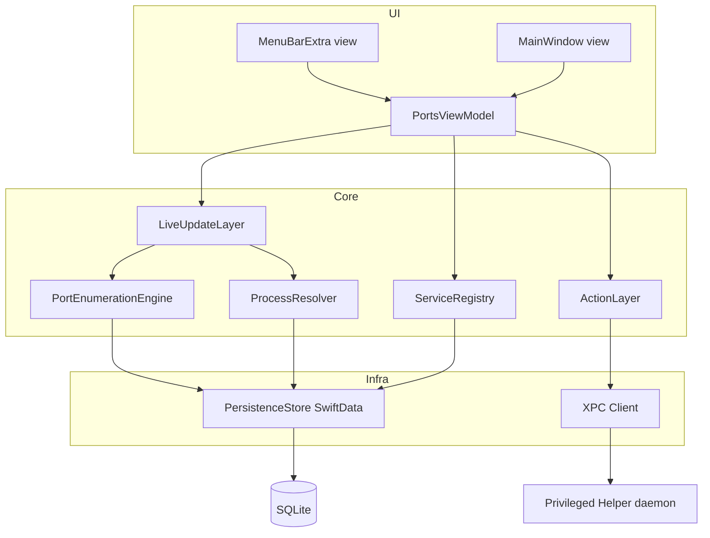
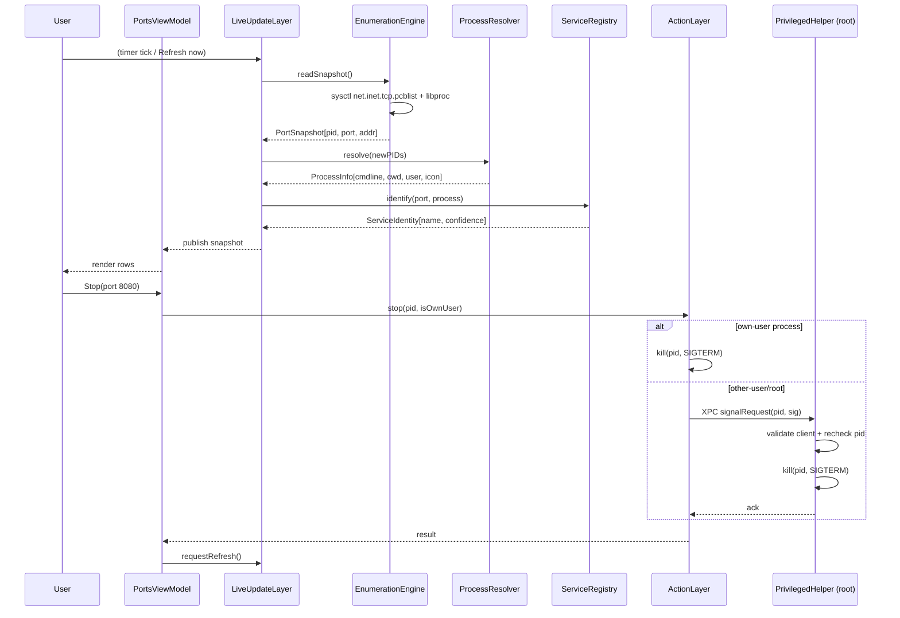

# Ports On — System Architecture (Stage 4)

## Inputs
- `.planning/_shared-context.md` (verified environment: macOS 26.7.3 Tahoe, Apple Silicon arm64, Xcode 27.2, Swift 6.4.2, greenfield repo, no backend, local-only persistence).
- Assigned concerns (a)–(f): PortEnumerationEngine, ProcessResolver, ServiceRegistry, live-update layer, persistence, privileged action layer.
- Technical grounding in the shared brief: `lsof` vs `sysctl`+`libproc`, App Sandbox + Hardened Runtime, `SMAppService`+XPC, TCC Full Disk Access, notarization.

## Completion condition
This document is complete when it defines the component/module boundaries for the SwiftUI menu-bar + main-window app, picks a primary enumeration mechanism with a grounded fallback, specifies the live-update cadence with justification, and includes a Mermaid component diagram and a refresh+identify+stop sequence diagram. No application code is written.

---

## 1. Architecture drivers

| Driver | Status | Source |
|---|---|---|
| Local desktop tool, no backend/remote DB | Confirmed | shared brief |
| Target macOS 26.x Tahoe, Apple Silicon | Confirmed | verified env |
| Must show port → process → service mapping | Confirmed | product goal |
| Stop/restart gated by privilege/ownership | Confirmed | product goal |
| Menu-bar presence + main window | Confirmed | product goal |
| Other users'/root process enumeration requires privilege | Confirmed | shared brief |
| Full Disk Access may gate full command lines of other users' processes | Confirmed | shared brief |
| Exact listener counts / growth / team size | Assumed | single-user dev tool, low thousands of sockets, 1 developer |

Only the confirmed drivers are hard. The assumed sizing (low socket counts, single user) means we bias to the **Lean** end: no daemons beyond the privileged helper, no caching tiers, no background services.

## 2. System context

```mermaid
flowchart LR
  U[User] -->|menu bar / window| APP[Ports On app]
  APP -->|sysctl pcblist + libproc| K[macOS kernel]
  APP -->|libproc proc_pidinfo| K
  APP -->|lsof subprocess (fallback)| LS[lsof binary]
  APP -->|XPC| HELP[Privileged Helper daemon]
  HELP -->|kill signal| K
  HELP -->|launchctl bootout/kickstart| LC[launchd]
  APP -->|SwiftData local store| DB[(Local SQLite)]
  APP -.->|TCC: Full Disk Access| P[Privacy subsystem]
```

Trust boundaries: the app runs as the console user, sandboxed. The privileged helper is a separate root launchd daemon reachable only over a validated XPC endpoint. The kernel is untrusted input for struct parsing (defensive sizing). The local DB holds only user prefs/overrides.

## 3. Candidate architecture styles

| Style | Fit | Verdict |
|---|---|---|
| Monolithic SwiftUI app | All concerns are in-process, local-only | **Chosen** |
| Modular monolith (feature modules in one target) | Separates engine/registry/UI compile units | **Chosen form** — one app target, internal modules |
| Microservices / separate processes | No backend, single user — unjustified | Rejected |
| Event-driven pub/sub bus | Overkill; polling is enough at this scale | Rejected as a backbone |

## 4. Component map and module boundaries

One app target, six internal modules. Each exposes a small interface; UI depends only on the top-level facade.

- **PortEnumerationEngine** — produces `PortSnapshot` (list of `ListeningPort {port, proto, pid, addr}`).
- **ProcessResolver** — enriches a PID into `ProcessInfo {pid, commandLine, cwd, userName, bundleID, icon}`.
- **ServiceRegistry** — maps port/process → `ServiceIdentity {name, category, confidence}` from known-port table + process-name fingerprint + user overrides.
- **LiveUpdateLayer** — owns the refresh cadence/timer and publishes snapshots to observers.
- **PersistenceStore** — SwiftData-backed prefs, user overrides, known-port table cache.
- **ActionLayer** — stop/restart; in-process `kill` for own processes, XPC to the privileged helper for others'/root.



Data flow rule: `LiveUpdateLayer` is the only writer of snapshot state; `PortsViewModel` is the only reader in UI; `ActionLayer` requests a refresh after a successful stop so state converges without a second path.

### (a) PortEnumerationEngine

Primary mechanism: **programmatic `sysctl` (`net.inet.tcp.pcblist`, `net.inet.udp.pcblist`) + `libproc` (`proc_pidinfo`/`proc_pidfdinfo`)**.

Rationale, grounded in the shared brief:
- `lsof` itself reads these same private sysctls (Apple Developer Forums 728731; spenceruresk PortMon), so the programmatic path reaches the same data without spawning a subprocess per refresh.
- At a 2s default cadence (see (d)), a subprocess spawn per tick is measurable CPU/battery cost for a menu-bar app; the sysctl path avoids it.
- `netstat -an` cannot be the source — it has no owning PID.
- `NWPathMonitor` reports path status only, not listeners — ruled out.

Fallback mechanism: **`lsof -nP -iTCP -sTCP:LISTEN`** (plus `-iUDP` when needed), parsed into the same `PortSnapshot`. Trigger conditions:
- The sysctl path returns an unexpected struct size / parse error on a future macOS minor (the sysctls are semi-private and version-sensitive per the shared brief).
- User opts into "Compatibility mode" in prefs.
- `sudo lsof` variant is used only when the user grants helper-based elevation for other-user visibility; the app itself stays unprivileged.

The engine normalizes both sources to one `PortSnapshot` type so the fallback is a drop-in swap behind a protocol, not a UI change.

### (b) ProcessResolver

Given a PID: `commandLine` via `proc_pidpath` and the `KERN_PROCARGS` sysctl; `cwd` via `proc_pidinfo` with `PROC_PIDVNODEPATHINFO` (own-user only); `userName` from the process owner UID; `bundleID`/`icon` from `NSRunningApplication` when the process is an app bundle, else a generic binary glyph. Full command lines of **other users'** processes may require Full Disk Access (TCC `SystemPolicyAllFiles`) — the resolver returns a "restricted" marker rather than an empty row so the UI can prompt.

### (c) ServiceRegistry

Three lookup tiers, first match wins, producing a `confidence`:
1. **User overrides** (persistence) — highest confidence, keyed by port or by bundle/process name.
2. **Process-name fingerprint** — small builtin table of name patterns (nginx, docker, node, next, astro, opencode, omp, …) mapped to friendly names/categories.
3. **Known-port table** — well-known port numbers (80/443/5432/6379/3000/8080 …).
Unmatched → `Unknown` with the raw command line shown as the label. The known-port and fingerprint tables ship as bundled static data; user overrides live in SwiftData.

### (d) Live-update layer

**Polling**, not event-driven. There is no public macOS API that emits "a socket started listening" events; `kqueue` `EVFILT_PROC` covers fork/exec/exit signals but not bind/listen transitions, and building a reliable event stream would require the same sysctl diffing we already do. So the default is:

- **Cadence: 2.0s while the main window is visible; 5.0s while only the menu bar is shown; paused when the app is otherwise idle.**
- Justification: 2s feels live for a dev tool and keeps sysctl-read cost negligible (the table read is a single kernel copy); 5s for menu-bar-only avoids background battery cost; pausing when fully idle removes the remaining cost.
- Each tick: engine snapshot → resolver enrichment only for **new/changed PIDs** (cache the rest) → publish `PortSnapshot` to observers on the main actor.
- Configurable in prefs (Off / 1s / 2s / 5s / 10s). A manual "Refresh now" bypasses the timer.

### (e) Persistence

**SwiftData** over raw SQLite for prefs + user overrides + a cached copy of the known-port table. Local-only, no remote sync (confirmed driver). Rationale in ADR-005. Schema is three small models: `AppPreference`, `ServiceOverride`, `ServiceAlias`. No migration risk at Phase 1; SwiftData handles the store file.

### (f) Action layer + privileged helper

Two paths, selected by ownership:
- **Own-user process:** in-process `kill(pid, SIGTERM)`, then SIGKILL after a grace window. No helper needed.
- **Other-user / root process:** XPC to a **root launchd daemon** registered via `SMAppService`, which performs the `kill` (and `launchctl bootout`/`kickstart` for restart of launchd-managed services). The daemon validates the XPC client (code-signing requirement, per WWDC23 environment constraints) and re-checks the target PID still exists before signaling.

`SMJobBless` / `AuthorizationExecuteWithPrivileges` are deprecated (shared brief) and are not used. The helper is a separate executable in the app bundle, Developer ID–signed and notarized alongside the app (shared brief).

Restart semantics: for a launchd service, restart = `launchctl kickstart -k`; for a plain process, restart = stop then re-exec the recorded command line (best-effort, surfaced as "may not restore original context"). Docker/Next/Astro style processes are restarted via their owning supervisor where detectable by the ServiceRegistry fingerprint.

## 5. Refresh + identify + stop — sequence



## 6. Deployment / runtime topology

- Single app process (sandboxed, hardened runtime, Developer ID–signed, notarized).
- One optional privileged helper daemon, installed on first elevated action, registered via `SMAppService`. It runs only on demand via XPC and exits when idle; single instance by definition (launchd daemon).
- No servers, no background agents beyond the helper, no multi-instance coordination. Two copies of the app running is prevented by the usual single-instance behavior; the SwiftData store is file-locked by the framework.
- Failure handling: if the helper is not installed or the user declines, elevated actions are disabled with an inline explanation; enumeration and own-user actions continue to work. If the sysctl parse fails, the engine falls back to `lsof` automatically and records a diagnostic.

## 7. Technology / infrastructure justification

| Item | Driver (confirmed) | Deferral impact |
|---|---|---|
| SwiftUI + MenuBarExtra | menu bar + window requirement | none |
| sysctl+libproc enumeration | no-subprocess, low-cost refresh | falls back to lsof automatically |
| lsof fallback | version-robustness of private sysctls | none |
| SwiftData | local-only persistence | none |
| SMAppService + XPC helper | stop other users'/root | elevated actions disabled |
| Hardened Runtime + notarization | distribution requirement | app won't launch on other Macs |
| TCC Full Disk Access prompt | full cmdline of other users | rows shown but restricted |

## Skill provenance
none

## Stage 12 review integration
Reviewed and cross-checked against `01`, `04`–`12`. Two reconciliations recorded in `12-architecture-review.md`:
- **C-1 (naming):** the persistence models named here (`AppPreference`, `ServiceOverride`, `ServiceAlias`) are superseded by the canonical schema in `05-database-design.md` (`UserPreference`, `ServiceOverride`, `ProcessFingerprint`, `ActionLogEntry`). `ServiceAlias` ≡ `ProcessFingerprint`; `ActionLogEntry` is an addition to reflect in the action layer. Align naming at implementation start.
- **C-2 (polling):** the 2s-window / 5s-menu-bar / paused-idle cadence here matches ADR-006 and governs; `08-performance-strategy.md`'s three-tier scheme is a refinement to validate against AC-P1..P6 in Phase 3, not a competing decision.
