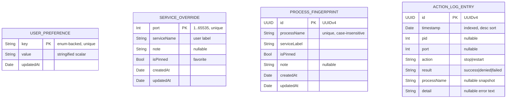

# Stage 6 — Database Design (Local Persistence)

## Inputs

- `.planning/_shared-context.md` — greenfield macOS Tahoe (26.x) app, Apple Silicon, Swift 6.4.2 / Xcode 27.2; local-only tool, **no remote DB, no backend**. Persistence scope limited to user preferences, user-defined service overrides / pinned ports / notes, and an optional small stop-restart history log.
- Product facts that shape the design: live port→process snapshots are re-enumerated every refresh (via `lsof`/`sysctl`+`libproc`) and are **transient**; user actions (stop/restart) are security-gated and may be audited.

## Completion condition

A reviewed design that fixes: the chosen store with rationale, an ERD of the persisted entities with fields/types/relationships, key + index notes, a SwiftData schema-versioning note, and an explicit statement of what is **not** persisted. Every requirement carries a unique `REQ-6xx` ID. No application code, no migrations executed — planning only.

---

## 1. Store decision

**Chosen: SwiftData** (`@Model` classes backed by a private SQLite store), single store, no third-party dependency.

**Why SwiftData over raw SQLite / GRDB:**

| Criterion | SwiftData | GRDB / raw SQLite |
|---|---|---|
| Data volume | Tiny (tens of rows). No query-planner pressure. | Overkill. |
| Schema evolution | Built-in `SchemaMigrationPlan` + `VersionedSchema` stages. | Hand-rolled migrations. |
| Integration | Native `@Query`/`ModelContext` in SwiftUI; Apple-first on Tahoe 26 SDK. | Manual wiring. |
| Dependencies | Zero (framework). | Adds a package for marginal benefit. |
| Ad-hoc SQL / raw perf | Not exposed (acceptable here). | Available (not needed). |

GRDB would be the right call if we needed raw SQL, FTS, or high write concurrency — none apply to a single-user desktop tool with this row count. Picking SwiftData keeps the dependency surface empty.

- **REQ-601** — All persistent user data is stored in one local SwiftData `ModelContainer` in the app's `Application Support/PortsOn/` directory. No network, no iCloud, no shared container.
- **REQ-602** — Preferences that are simple scalars (refresh cadence, start-at-login, theme) are persisted as rows in the store (not `UserDefaults`) so that the whole user-config surface has one source of truth, one backup path, and one versioning story. *Trade-off accepted:* `UserDefaults` would be marginally simpler, but splitting config across two stores complicates reset/backup and schema evolution.

## 2. Entity catalogue

| Entity | Purpose | Cardinality (per install) |
|---|---|---|
| `UserPreference` | Key/value app settings (refresh cadence, start-at-login, theme). | ~3–10 rows |
| `ServiceOverride` | User-defined port→service-name label + free-text note + pinned flag. | 0–few hundred |
| `ProcessFingerprint` | Custom process-name fingerprints (map a process name/substring → a friendly service label), independent of a specific port. | 0–few dozen |
| `ActionLogEntry` | Optional audit trail of stop/restart attempts (timestamp, pid, port, action, result). | grows over time; capped (see §6) |

`ServiceOverride` and `ProcessFingerprint` are **deliberately separate**: a fingerprint labels *who owns a port* (by process identity), a port override labels *what a port is* (by number). Conflating them in one table with nullable port would blur two distinct user intents and force a partial-unique constraint.

## 3. ERD

Relationships: **none between the four entities** — they are independent user-config/audit records. No foreign keys. This is intentional: an `ActionLogEntry` references a pid that no longer exists, and a `ServiceOverride` must survive even if no fingerprint matches it. Forcing relations here would create delete-cascade hazards for zero integrity benefit.

## 4. Logical schema, keys, indexes

SwiftData `@Model` mapping (types as stored):

- **REQ-603** — `UserPreference`: `@Attribute(.primaryKey) key: String`, `value: String`, `updatedAt: Date`. Natural key on `key`. The `key` values come from a closed Swift enum (`refreshCadenceSeconds`, `startAtLogin`, `theme`, …) validated in code, not by a DB constraint.
- **REQ-604** — `ServiceOverride`: `@Attribute(.primaryKey) port: Int`, `serviceName: String` (non-optional), `note: String?`, `isPinned: Bool = false`, `createdAt/updatedAt: Date`. Natural PK on `port`; enforce `1...65535` at the model layer (check-constraint equivalent) and uniqueness is guaranteed by the PK.
- **REQ-605** — `ProcessFingerprint`: `id: UUID` (`.primaryKey`), `processName: String` with `#Unique`, `serviceLabel: String`, `isPinned: Bool`, `note: String?`, timestamps. Match against live process names is case-insensitive → normalize to lowercase on write, index the lowered value.
- **REQ-606** — `ActionLogEntry`: `id: UUID` (`.primaryKey`), `timestamp: Date` (`.indexed()`), `pid: Int?`, `port: Int?`, `action: String`, `result: String`, `processName: String?`, `detail: String?`. Index on `timestamp` because the only real query is "recent actions, newest first."

**PK strategy note:** Natural keys (`port`, `key`) are used where a real-world unique attribute exists — they prevent duplicate overrides by construction. Synthetic `UUID` (v4) is used for `ProcessFingerprint` and `ActionLogEntry`, which have no stable natural identity. UUIDv7 (time-ordered) would slightly help `ActionLogEntry` locality, but Apple's `UUID` does not ship a v7 generator; the row count doesn't justify a custom implementation, so v4 + a `timestamp` index is the boring, correct choice.

**Indexes summary** (only where a known query needs it — no speculative indexes):

| Table | Index | Justifying query |
|---|---|---|
| `UserPreference` | PK on `key` | load-all / upsert-by-key at launch |
| `ServiceOverride` | PK on `port` | O(1) lookup when rendering a live port row |
| `ProcessFingerprint` | unique on `processName` (lowered) | match fingerprint against each live process |
| `ActionLogEntry` | index on `timestamp` | history view, newest-first |

## 5. Normalization & constraints

- Schema is in 3NF trivially: each non-key attribute depends on its entity's key; no repeating groups, no derived stored columns (nothing is computed from other columns).
- `ActionLogEntry` **intentionally denormalizes** `processName`/`port`/`pid` as point-in-time snapshots — an audit record must reflect what was true at action time, not be re-resolved via joins that could go stale.
- Enums (`action`, `result`, preference `key`) are validated at the Swift model boundary; SwiftData on this store does not expose native CHECK constraints, so the app layer is the enforcement point. Documented here so reviewers know validation is not optional.

## 6. Transaction boundaries & lifecycle

- **REQ-607** — Each user intent is one `ModelContext` transaction: "save a port override", "toggle pin", "append one log entry" are single, small, auto-committed writes. There are no multi-entity invariants, so no explicit cross-entity transactions are needed.
- **REQ-608 (history retention)** — `ActionLogEntry` is capped (e.g. keep most recent N=1000 or last 90 days; exact number set by the architect). **Mechanism options:** (a) *lazy/on-append* — after inserting a new entry, delete oldest rows beyond the cap in the same context save (idempotent, no scheduler, runs only when the app writes, safe if the app is killed mid-way because the cap is re-enforced on the next append); (b) *scheduled purge* — a background job trimming by age. **Recommendation: (a)**, because it needs no runner, is self-healing, and the failure mode (a slightly over-cap store until the next action) is harmless. If a time-based purge across sessions is required, escalate to the parent architect to name the runner — the data design does not assume a scheduler exists.
- Backup/restore: the store is a single file under `Application Support/PortsOn/`; documenting its path is the backup story. No seed data — a fresh install starts with zero rows and default in-code preference values.

## 7. Migration / versioning note

- **REQ-609** — Ship a `VersionedSchema` enum (e.g. `SchemaV1`) from day one, even for the initial release, and a `SchemaMigrationPlan` with an empty `stages:` array. This costs nothing now and makes the first real change a one-line addition instead of a retrofit.
- Additive changes (new optional field, new entity) go into `SchemaV2` with a lightweight migration stage; SwiftData performs automatic lightweight migration for added optional/defaulted fields.
- Breaking changes (renamed/retyped field) require an explicit `MigrationStage.custom(fromVersion:toVersion:willMigrate:didMigrate:)`. Keep transforms pure and idempotent.
- Because the store is local and un-versioned by any server, a migration failure must never brick the app: wrap container setup so a failed migration falls back to a readable error state rather than a crash. (Exact recovery UX is the architect's call — flagged, not designed here.)

## 8. What is NOT persisted

- **REQ-610** — Live port/process **snapshots are transient**, held in memory only (a view-model cache refreshed on each poll). They are never written to the store: they change every refresh cycle, storing them would create stale reads and unbounded growth, and they carry no user intent. Only *user-authored* interpretations of that data (overrides, fingerprints, pins, notes) and *user-initiated actions* (audit log) are persisted.
- Not persisted: OS-level process metadata beyond what's needed for a log line, credentials/secrets (none exist), any network-derived data (the app is offline/local).

## 9. Risks, assumptions, unresolved

- **Assumption:** store stays small (< thousands of rows). If a future feature bulk-imports overrides, revisit SwiftData vs GRDB.
- **Assumption:** no multi-window concurrent writers; SwiftData's main-actor `ModelContext` suffices. Background enumeration must not write snapshots to the store (per REQ-610).
- **Open for parent architect:** exact history cap (row count vs age) and the retention mechanism confirmation (§6); whether `launchctl`-dependent "start at login" state should live in `SMAppService` rather than the preference store.

## Skill provenance

- Read `backend-development` SKILL.md — reviewed its DB-design checklist (constraints, indexing, migration, retention). Mostly server/DBMS-oriented; applied its "index only for known queries" and "plan migrations from v1" principles to the local SwiftData design, and used its retention question to drive REQ-608's lazy-vs-scheduled analysis. No server/SQL guidance carried over (no remote DBMS exists here).

## Stage 12 review integration
Reviewed and cross-checked against `03`/`04` (ADR-005), `06`, and `09`. Dispositions in `12-architecture-review.md`:
- **This schema is canonical** for persistence model naming (resolves C-1). `03`/`04` must align `AppPreference`→`UserPreference`, `ServiceAlias`→`ProcessFingerprint`, and account for `ActionLogEntry`.
- **C-2 (polling):** this doc is unaffected; ADR-006 cadence governs.
- **Open items carried forward:** history-cap value (R-SEC-3 / D-8) and the `ServiceKey` override granularity (`06` open q.5) must be pinned before the override store is built (Phase 1).
