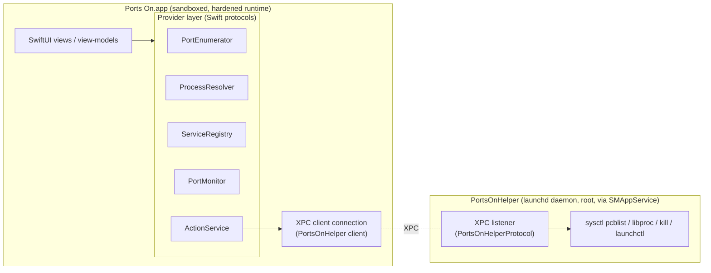

# Stage 7 — API Contracts (Ports On)

## Inputs
- `.planning/_shared-context.md` — verified environment (macOS 26.7.3 Tahoe, arm64, Xcode 27.2, Swift 6.4.2), enumeration ground truth (`lsof`, `netstat`, `sysctl net.inet.*.pcblist` + `libproc`), sandbox/helper guidance (`SMAppService`, deprecated `SMJobBless`), TCC/FDA notes, and the fact that Ports On is a **local** tool with **no backend**.
- Greenfield repo — no existing code, conventions, or API surface to reconcile.
- Task scope: define **internal** contracts only — the in-process Swift provider API the UI consumes, and the XPC protocol between the sandboxed app and the privileged helper. No public network API.

## Completion condition
A reviewer can point at any UI flow (list ports, inspect a port→process→service, watch for changes, stop/restart) and find the exact Swift-facing operation, its inputs/outputs/error cases, and — for stop/restart — the XPC message, auth/validation checks, and error semantics that carry it out, plus a recorded statement that there is no public network API.

---

## 1. Consumers and boundary overview

There are exactly **three** internal consumers and **no external/network** consumers:

| Consumer | Boundary it crosses | Contract it uses |
|---|---|---|
| SwiftUI UI (views / view-models) | in-process, same binary | Swift provider protocols (`PortEnumerator`, `ProcessResolver`, `ServiceRegistry`, `PortMonitor`, `ActionService`) |
| Privileged helper (launchd daemon via `SMAppService`) | out-of-process, root | XPC protocol `PortsOnHelperProtocol` |
| Privileged helper → kernel/system | root, on-host only | `sysctl`/`libproc`/signals — **not** part of these contracts (implementation detail of the helper) |

Ports On is a local desktop tool. The "API" is therefore the app's internal seams, not a service interface.



The authoritative privilege boundary is the **helper**: the app never performs an elevated action itself; it asks the helper over XPC, and the helper is the enforcement point that decides whether to act.

---

## 2. Recommended API style

| Decision | Choice | Rationale | Alternative considered |
|---|---|---|---|
| UI-facing surface | Swift `protocol`s, `async`/`await`, value types (`Sendable` structs), injected via environment | Testable, swappable (real vs. mock), matches Swift 6.4 concurrency | Closure/callback service locator — harder to test, no clear ownership |
| Change subscription | `AsyncSequence` (`AsyncStream<PortsSnapshot>`) | Idiomatic structured-concurrency consumption; cancellable | `Combine` publishers — extra dependency on reactive pattern |
| App↔helper transport | XPC with `NSSecureCoding` message objects (mirror of `NSXPCInterface`) | Standard, secure, supports `SMAppService` daemons | Local HTTP/Unix socket — more attack surface, no framework support for daemons |
| Message schema | Explicit `APIVersion` handshake on connect | Lets app detect helper mismatch and prompt reinstall | Implicit "hope versions match" — fragile across updates |
| Error model | Single typed error enum per layer + a shared user-facing `PortsOnError` | One place to define codes; UI maps codes→copy | `throws` with untyped `Error` — loses code/underlying split |

Justification: this is a single-vendor, single-machine, two-process system. REST/GraphQL/HTTP are rejected outright — there is no network peer (see §9).

---

## 3. Shared data types

These value types are the vocabulary of every contract below. Defined once, owned by the provider layer.

| Type | Purpose | Key fields (sketch) |
|---|---|---|
| `PortEntry` | One listening socket row | `port: UInt16`, `addressFamily: AddressFamily` (`.ipv4`/`.ipv6`), `bindAddress: String` (`0.0.0.0`/`::`/specific), `protocol: TransportProtocol` (`.tcp`/`.udp`), `pid: pid_t?`, `processName: String?` |
| `PortsSnapshot` | Immutable list at a point in time + generation | `entries: [PortEntry]`, `generation: UInt64`, `collectedAt: Date`, `visibility: Visibility` |
| `Visibility` | What the enumerator could actually see | `enum { full, partial(reason: VisibilityReason) }`; `VisibilityReason ∈ { missingHelper, missingFullDiskAccess, restricted }` |
| `ProcessDetail` | PID → rich info | `pid: pid_t`, `name: String`, `bundleID: String?`, `ownerUserName: String`, `commandLine: [String]`, `executablePath: String?`, `parentPID: pid_t?`, `isElevated: Bool` (root?), `launchOrigin: LaunchOrigin?`, `listeningPorts: [UInt16]`, `memoryFootprintBytes: UInt64?`, `startedAt: Date?` |
| `LaunchOrigin` | How the process was started (drives restart strategy) | `enum { launchdService(label: String), dockerContainer(id: String, name: String), standalone }` |
| `ServiceIdentification` | Friendly identity of what owns a port/process | `kind: ServiceKind`, `displayName: String`, `detail: String?` |
| `ServiceKind` | What was recognized | `enum { wellKnownPort, launchdService, dockerContainer, packageManagerRuntime, userProcess, unknown }` |
| `ActionRequest` | A stop/restart intent | `target: ProcessTarget`, `action: ProcessAction`, `requestID: UUID` |
| `ProcessTarget` | What to act on | `.pid(pid_t)` or `.port(UInt16, AddressFamily)` (resolved to PID first) |
| `ProcessAction` | The verb | `enum { stop(graceSeconds: Int), restart }` |
| `ActionOutcome` | Result of an action | `enum { direct, viaPrivilegedHelper }` (recorded for the activity log / audit) |
| `HelperStatus` | Helper availability for gating UI | `enum { ready, notInstalled, needsUpdate(installed: APIVersion, required: APIVersion), unavailable(reason: String) }` |

`pid_t`-bearing types treat a missing/`nil` PID as "socket owned by a process this caller cannot see" — never as PID 0.

---

## 4. Provider operation catalogue (traceability)

Every operation maps to a capability and a consuming screen. Operations with no consumer are deferred (§10).

| Op | Protocol.method | Consuming screen / client | Priority |
|---|---|---|---|
| List active listeners | `PortEnumerator.list()` | Ports list (main) | Must |
| Refresh snapshot on demand | `PortEnumerator.refresh()` | Pull-to-refresh / toolbar Refresh | Must |
| Resolve PID → detail | `ProcessResolver.detail(of:)` | Port/process inspector detail pane | Must |
| Resolve port → owning PID | `ProcessResolver.owner(of:)` | Row expansion from port | Must |
| Look up service for a port | `ServiceRegistry.service(forPort:)` | Row "service" column | Must |
| Look up service for a process | `ServiceRegistry.service(forProcessName:)` | Inspector "service" section | Must |
| Override recognized service | `ServiceRegistry.setOverride(_:for:)` | Inspector "label this service" | Should |
| Subscribe to changes | `PortMonitor.changes()` | Live list updates | Must |
| Read current monitor snapshot | `PortMonitor.current()` | Initial render / reconnect | Must |
| Report helper availability | `PortMonitor.helperStatus()` | Banner / enable stop buttons | Must |
| Request stop | `ActionService.stop(_:)` | Row/inspector Stop button | Must |
| Request restart | `ActionService.restart(_:)` | Inspector Restart button | Should |

---

## 5. Swift provider protocols (interface sketches)

Signatures only — no bodies, no implementation.

```swift
/// Lists currently-listening sockets on the local machine.
protocol PortEnumerator: Sendable {
    /// Returns one row per listening socket.
    /// - Parameter includeUDP: include UDP listeners (default true).
    /// Throws `PortsOnError` (see §7). Never returns PID 0 for a real owner.
    func list(includeUDP: Bool) async throws -> PortsSnapshot

    /// Forces a fresh collection, bypassing any in-flight cache/coalescing.
    func refresh() async throws -> PortsSnapshot
}

/// Maps a PID to rich process information, and a port to its owning PID.
protocol ProcessResolver: Sendable {
    /// Full detail for a PID. Throws `.processNotFound` if gone,
    /// `.notPermitted` if this caller cannot read it (see FDA note, §8).
    func detail(of pid: pid_t) async throws -> ProcessDetail

    /// Owning PID for a bound port, if visible to the caller.
    /// Returns `nil` when the port is bound by a process the app can't see.
    func owner(of port: UInt16, family: AddressFamily,
               proto: TransportProtocol) async throws -> pid_t?
}

/// Recognizes and (optionally) lets the user override what a port/process is.
protocol ServiceRegistry: Sendable {
    /// Best-effort friendly identity for a port. Never throws for "unknown" —
    /// returns `.init(kind: .unknown, displayName: "Unknown")`.
    func service(forPort port: UInt16) async -> ServiceIdentification

    /// Friendly identity for a process by name (e.g. "node", "com.docker.backend").
    func service(forProcessName name: String) async -> ServiceIdentification

    /// Persists a user override locally (e.g. relabel a port). Idempotent per key.
    /// Throws `.storeUnwritable` if the local override store can't be written.
    func setOverride(_ id: ServiceIdentification?, for key: ServiceKey) async throws
}

/// Streams port-table changes and reports helper availability.
protocol PortMonitor: Sendable {
    /// Emits a `PortsSnapshot` whenever the listening set changes (debounced).
    /// The stream never completes normally; cancel to stop.
    /// Throws `.monitorUnavailable` if the underlying source can't be opened.
    var changes: AsyncThrowingStream<PortsSnapshot, Error> { get }

    /// Latest snapshot without waiting for a change (for initial render).
    func current() async -> PortsSnapshot

    /// Whether the privileged helper is installed/authorized and at a
    /// compatible version — gates stop/restart affordances in the UI.
    func helperStatus() async -> HelperStatus
}

/// Executes stop/restart, choosing the direct or privileged path.
protocol ActionService: Sendable {
    /// Stops a process. Owned-by-current-user targets are signaled directly;
    /// other users'/root targets are routed to the helper via XPC (§6).
    /// Throws `PortsOnError` on any failure; reports the path taken via
    /// `ActionOutcome` in the returned activity entry.
    func stop(_ target: ProcessTarget, graceSeconds: Int) async throws -> ActionOutcome

    /// Restarts a process. Strategy follows `LaunchOrigin`
    /// (launchd: `launchctl kickstart -k`; docker: `docker restart`; standalone:
    /// helper relaunches via recorded executable/argv). Throws `.unsupportedRestart`
    /// when no restart strategy applies.
    func restart(_ target: ProcessTarget) async throws -> ActionOutcome
}
```

Notes:
- `PortEnumerator.list` and `PortMonitor.current` are **safe**: reading port tables causes no user-visible state change (log/telemetry aside).
- `ActionService` is the **only** provider permitted to cross the privilege boundary; the other four are read-only.

---

## 6. XPC protocol (app ⇄ privileged helper)

`SMAppService`-registered launchd daemon running as root; the sandboxed app connects as client. The helper is the authoritative enforcement point.

### 6.1 Connection & auth/validation expectations

| # | Requirement |
|---|---|
| REQ-111 | On connect the app and helper perform an `APIVersion` handshake; mismatch → `.versionMismatch` and the app prompts reinstall of the helper. |
| REQ-112 | The app validates the helper using a **code-signing requirement** pinned to Ports On's team/identifier; a helper that fails validation is never used. |
| REQ-113 | The helper validates each incoming XPC connection back to the signed Ports On app (peer code requirement) and rejects all other peers. **This reverse check is authoritative** — being root is not an authorization. |
| REQ-114 | All message fields use `NSSecureCoding`-conformant classes; no untyped dictionaries cross the boundary. |
| REQ-115 | The helper runs each mutating request inside a bounded window and refuses concurrent actions on the same PID (returns `.busy`). |

```swift
@objc protocol PortsOnHelperProtocol {
    // Each message takes a reply block. Requests carry requestID for idempotency.
    func handshake(version: APIVersion, reply: @escaping (APIVersion) -> Void)

    func stopProcess(_ request: StopRequest,
                     reply: @escaping (ActionResponse) -> Void)

    func restartProcess(_ request: RestartRequest,
                        reply: @escaping (ActionResponse) -> Void)

    func helperStatus(reply: @escaping (StatusResponse) -> Void)
}
```

### 6.2 Message set

| Message | Direction | Fields | Reply |
|---|---|---|---|
| `HandshakeRequest` | app→helper | `clientVersion: APIVersion` | `APIVersion` (helper's) — enables REQ-111 |
| `StopRequest` | app→helper | `requestID: UUID`, `pid: pid_t`, `signal: SignalKind` (`.sigTerm`/`.sigKill`), `graceSeconds: Int` | `ActionResponse` |
| `RestartRequest` | app→helper | `requestID: UUID`, `pid: pid_t`, `strategy: RestartStrategy` (`launchd{label}`, `docker{containerID}`, `standalone{exePath, argv}`, `none`) | `ActionResponse` |
| `StatusRequest` | app→helper | — | `StatusResponse{ helperVersion, root: Bool, activeActions: Int }` |
| `ActionResponse` | helper→app | `requestID: UUID`, `result: Result<ActionPerformed, HelperError>` | — |
| `ActionPerformed` | helper→app | `pid: pid_t`, `outcome: ActionOutcome`, `completedAt: Date` | — |

### 6.3 Error semantics

`HelperError` (helper side) maps onto `PortsOnError` (app side, §7) 1:1 where possible:

| Helper code | Meaning | App-visible behavior |
|---|---|---|
| `.denied` | Peer failed REQ-113 validation | Surface as authorization failure; do not retry |
| `.processNotFound` | PID gone / not visible | Refresh list; ignore stale row |
| `.notPermitted` | Signal rejected by kernel even as root (e.g. protected) | Show "cannot stop this process" |
| `.unsupportedRestart` | No `RestartStrategy` applies | Disable Restart for that row |
| `.busy` | Action already in flight for PID (REQ-115) | Retry with backoff |
| `.timeout` | Grace elapsed, escalation failed | Offer "Force stop" (`.sigKill`) |
| `.versionMismatch` | REQ-111 failed | Prompt helper reinstall |
| `.internal(code: String)` | Unexpected | Log + generic failure copy |

### 6.4 Concurrency, idempotency, retries
- **Idempotency (REQ-116):** `requestID` is a client UUID. The helper keeps a short-lived (e.g. 30 s) dedupe window keyed by `requestID` so an app-level retry of the same logical action cannot double-stop/double-restart. A *new* user action gets a fresh `requestID` and is not deduped.
- **Retries (REQ-117):** `.busy` and transient `.timeout` are the only retryable codes; the app retries with exponential backoff, capped (e.g. 3 attempts), and surfaces `Retry-After`-style guidance in the error copy. `.denied`/`.versionMismatch`/`.notPermitted` are terminal — never auto-retried.
- **Long-running ops:** signaling is bounded (grace + escalation), so no progress streaming is needed; `restart` for `launchd`/`docker` is a single subprocess call. No async job handles in v1.

---

## 7. Validation and shared error contract

One enum, two layers. `underlying` carries the OS/`errno`/XPC detail for logs only — never shown raw in UI.

```swift
enum PortsOnError: Error {
    case enumerationFailed(underlying: String)   // sysctl/lsof source error
    case processNotFound(pid: pid_t)
    case notPermitted(pid: pid_t, needsFullDiskAccess: Bool)
    case helperUnavailable(HelperStatus)          // notInstalled/needsUpdate/…
    case actionFailed(code: HelperError, pid: pid_t?)
    case unsupportedRestart(pid: pid_t)
    case storeUnwritable                          // ServiceRegistry override store
    case monitorUnavailable(underlying: String)
}
```

Validation rules:
- `ProcessTarget.port` must resolve to a live PID before an action is sent; if it can't, fail fast client-side with `.processNotFound` rather than round-tripping to the helper.
- `graceSeconds` is bounded (e.g. 1…30); out-of-range is clamped, not rejected.
- `ServiceRegistry.setOverride` accepts a nil override (clears); keys are validated (known port range / non-empty process name).

Rate limiting: the only "rate-limited" surface is the helper's per-PID action lock (REQ-115) returning `.busy` with backoff (REQ-117). Read paths (`list`, `refresh`, monitor) are coalesced/debounced rather than rejected.

---

## 8. Pagination / filtering / sorting / auth notes

- **No pagination.** A host's listening set is bounded (typically hundreds); `PortsSnapshot` returns all rows. The UI sorts/filters locally (port, process, service, address family).
- **Sorting/filtering** are UI concerns over the snapshot, not provider parameters (keeps provider API minimal).
- **Authorization:** two independent gates, neither sufficient alone:
  1. **App Sandbox / Hardened Runtime** — the app runs sandboxed; reading other users' processes needs the helper (REQ-112/113).
  2. **TCC Full Disk Access** (`SystemPolicyAllFiles`) — obtaining full command lines / other users' process detail can require FDA. `Visibility`/`VisibilityReason` (§3) and `notPermitted(needsFullDiskAccess:)` (§7) exist so the UI can explain *why* rows are incomplete rather than silently showing fewer. **FDA is a user-consent gate, not an authentication**; it must never be treated as authorizing an action.
- The helper reports `Visibility`-relevant facts (e.g. it can see all users) so `PortsSnapshot.visibility` reflects the combined capability.

---

## 9. No public network API (recorded decision)

**REQ-119 — There is no public network API in Ports On.** The product is a local desktop tool. There is no server, no remote database, and no telemetry endpoint. Rationale:
- All data (ports, processes, services) is read from the local kernel and local launchd/docker state; there is nothing to serve remotely.
- Exposing a network surface would add attack surface (an unauthenticated remote "stop a process" endpoint would be a severe risk) for zero product value.
- Persistence (service overrides) is local-only by design.

Consequence: no REST/GraphQL/RPC-over-HTTP contract, no auth tokens, no CORS, no versioned public schema. The only cross-process boundary is the local XPC helper channel (§6), which is peer-validated and never network-exposed. If a future feature (e.g. remote host monitoring) is added, it is a **new** contract, not an extension of these.

---

## 10. Deferred operations

| Deferred op | Why not in baseline | Trigger to add |
|---|---|---|
| `PortMonitor.changes` delta/diff events | Full snapshots suffice at expected scale | Snapshots proven too large / too chatty |
| `ActionService` bulk stop/restart | No UI consumes batch actions | A "stop all on port X" affordance ships |
| Helper "install/uninstall helper" ops over XPC | `SMAppService` handles install out-of-band | In-app helper management UI |
| `ServiceRegistry` history / audit query | No consumer | Activity-log viewer |
| `ProcessResolver` open-files / network-connection detail | Out of product scope (port manager, not general monitor) | Scope expansion to general process inspector |

---

## 11. Open questions / inconsistencies for the architect

1. **FDA dependency on `detail(of:)`** — reading other users' full command lines may need Full Disk Access. Confirm whether the helper (root) bypasses FDA or whether the user must grant it; this changes whether `notPermitted(needsFullDiskAccess:)` is reachable. Flagged to data/system design.
2. **Standalone restart strategy** — relaunching a non-launchd, non-docker process from a recorded `exePath/argv` is fragile (cwd, env, TTY). Confirm product appetite; may degrade to `.unsupportedRestart` for standalone in v1.
3. **Programmatic enumeration source** — `sysctl pcblist` + `libproc` (fast, semi-private) vs. shelling to `lsof` (stable, slower). This is a system-design choice, but it constrains `Visibility` semantics; the API above is source-agnostic by intent.
4. **UDP "listeners"** — UDP has no LISTEN state; confirm whether UDP bindings belong in the baseline list or are filtered by default (`includeUDP` parameter exists either way).
5. **Override persistence scope** — `ServiceKey` granularity (per-port? per-port+family? per-process-name?) is unspecified; needs a data-model decision before the override store is built.

---

## Skill provenance
- none — no skills were read for this stage; the document is derived from `.planning/_shared-context.md` and the assigned scope.

## Stage 12 review integration
Reviewed and cross-checked against `03`, `05`, `07`, and `12`. Dispositions in `12-architecture-review.md`:
- **Enumeration source (open q.3)** resolved by ADR-002: sysctl+libproc primary, `lsof` fallback; the contracts here are source-agnostic by design and remain valid either way.
- **UDP "listeners" (open q.4)** deferred to owner decision D-4; `includeUDP` parameter stands.
- **FDA dependency (open q.1)** and **restart fragility (open q.2)** remain open and are gated by Phase 0 evidence / owner decisions (D-1, D-10, RISK-06). The `notPermitted(needsFullDiskAccess:)` path must stay reachable until FDA-bypass is settled.
- **Override granularity (open q.5)** needs a data-model decision before the override store is built (Phase 1), per `05-database-design.md`.
