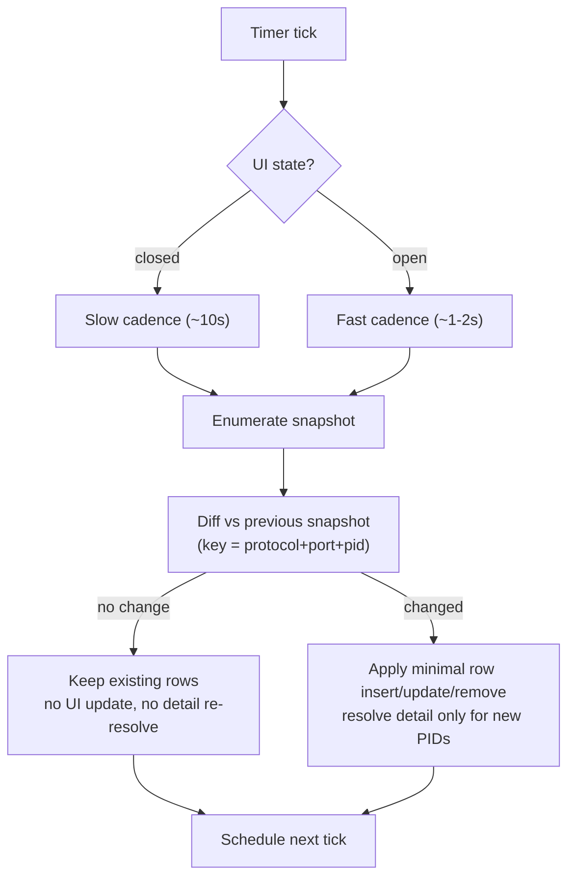

# Stage 9 — Performance Strategy

## Inputs
- `/.planning/_shared-context.md` (verified environment: macOS 26.7.3 Tahoe, arm64; no `/proc` on macOS; `lsof` uses private sysctls `net.inet.tcp.pcblist`; programmatic path via `sysctl` PCB lists + `libproc` `proc_pidinfo`/`proc_pid_fdinfo`; sandbox, `SMAppService` privileged helper, TCC/FDA constraints).
- App shape from shared context: local menu-bar tool, enumeration → port→process→service mapping, security-gated stop/restart. No remote backend, no server.
- No confirmed user-supplied numbers in the brief. **Every quantitative value below is ASSUMED and labeled as a target to verify, never a measurement.** Open questions at the end.

## Completion condition
This stage is complete when `08-performance-strategy.md` contains: a workload model with labeled assumptions; an enumeration-cost comparison (CLI `lsof` vs sysctl+libproc) with a recommended default and refresh cadence; a lazy-resolution plan for process detail; a live-watch strategy (adaptive polling + diffing); memory/cache policy; UI responsiveness plan (off-main-actor, virtualized lists); a measurable budget/target table; scalability limits; and acceptance criteria — all with confirmed/assumed labels and unique REQ IDs.

---

## 1. Workload model

Ports On is a **single-user, single-machine observer**, not a service. The "load" is entirely a function of (a) how many sockets the kernel reports and (b) how often the UI asks for a fresh snapshot.

| Driver | Assumed value | Source |
|---|---|---|
| Typical listening sockets on a dev Mac (Docker, node, brew services, etc.) | 20–80 | **Assumed** |
| Total TCP/UDP sockets incl. established/time-wait (what the PCB list returns before filtering) | 300–2,000 | **Assumed** |
| Peak on a busy machine (many containers, browsers) | ~5,000 sockets | **Assumed** |
| Enumeration requests | Menu open → continuous; menu closed → background cadence | By design (see §3) |
| Read:write ratio | ~100:1 (reads/enumeration dominate; writes only on stop/restart) | **Assumed** |
| Payload per snapshot | O(#sockets) structs, tens of KB, held transiently in RAM | Derived from §2 |

Peak-to-average is driven by UI state, not user count: average is the closed-menu cadence, peak is the open-menu cadence. There is no fan-out (one user, one machine), so **throughput is irrelevant; latency and idle cost are everything.**

## 2. Enumeration cost: CLI `lsof` vs sysctl + libproc

### 2a. CLI-subprocess approach (`lsof`)
Mechanism per refresh (shared context): spawn `/usr/sbin/lsof -nP -iTCP -sTCP:LISTEN`, optionally under `sudo`. Costs:
- **Process spawn + exec + dynamic-loader** setup each call — a fixed per-refresh tax paid even if nothing changed.
- **Privilege path**: seeing all users + full command lines requires `sudo`, which means either a password prompt per refresh or a privileged helper (shared context: `SMAppService` daemon). The helper path adds an XPC round-trip per refresh.
- **Output parsing**: `lsof` emits text that must be parsed line-by-line; the app pays for formatting it didn't ask for.
- **Two-step resolution**: `lsof` already maps socket→PID, but command line/cwd may need follow-up work.

Bottleneck path: refresh → fork/exec → lsof internally does the *same* sysctl+libproc work → format text → app parses text. The subprocess layer is pure overhead stacked on the programmatic path.

### 2b. Programmatic approach (`sysctl` PCB lists + `libproc`)
Mechanism per refresh (shared context): `sysctl` `net.inet.tcp.pcblist` / `net.inet.udp.pcblist` returns the kernel socket tables directly; map each socket to a PID via `libproc` (`proc_pidinfo`/`proc_pid_fdinfo`).
- **No subprocess, no text parsing.** Data arrives as structs already in the shape the app needs.
- **Per-socket work is bounded and local**: iterate the returned PCB buffer; per listening socket, one `proc_pidinfo` call to resolve the owner.
- **Same privilege constraint** applies (other users' PIDs), but it is paid once via the privileged helper connection, not re-paid as a spawn per refresh.

Cost sketch (model, not measurement): CLI ≈ fixed spawn/exec/dyld/parse cost **+** the programmatic cost; programmatic ≈ sysctl buffer copy **+** (#listening sockets × one `proc_pidinfo`). The programmatic path strictly removes the fixed overhead.

### 2c. Recommendation
**REQ-090 — Default enumeration = programmatic `sysctl` PCB lists + `libproc`, not a `lsof` subprocess.** Rationale: eliminates per-refresh spawn/parse tax, the dominant fixed cost for a frequently-polled menu-bar tool; the trade-off (semi-private interfaces needing per-macOS-version struct care, per shared context) is a correctness/maintenance cost, not a per-refresh runtime cost. 

**REQ-091 — Keep a `lsof` subprocess path available only as a diagnostic/fallback** behind a debug setting, never as the default, so a struct-mismatch regression on a future macOS version is observable rather than silent.

### 2d. Refresh cadence (recommended default)
Because there is no push source for socket changes (no `/proc`, no listener API), the app must poll. Cadence should track UI state:

| UI state | Cadence | Rationale |
|---|---|---|
| Menu closed (background) | every ~10 s | **Assumed**; keeps tray count fresh, near-zero average CPU |
| Menu open, idle (no interaction) | every ~2 s | **Assumed**; table visibly live without burning CPU |
| Menu open, actively interacting | every ~1 s | **Assumed**; responsive feel during scroll/filter |
| Immediately after stop/restart action | one forced refresh | Correctness: reflect the change the user just caused |

**REQ-092 — Cadence is a function of UI state, per the table above**, with the closed-menu value the slowest. All cadence numbers are **assumed** targets to tune against the CPU budget in §7.

## 3. Process-detail resolution: lazy, on-demand

Resolving *everything* up front (command line, cwd, full `proc_pidinfo` per PID) for every port in the table is the most expensive thing the app could do. `proc_pidinfo` is a per-PID syscall-ish call; multiplying it by every socket on a 5,000-socket machine is O(#sockets) privileged calls per refresh for data most rows never show.

**REQ-093 — Enumerate cheaply first (PID + port + protocol + state), resolve detail lazily.** The live table shows port/PID/state; command line, cwd, service name, and binary path are fetched **only** for the row(s) the user expands or selects.

**REQ-094 — Detail resolution is cached per PID with invalidation on process exit** (PID reuse and death both invalidate). A resolved PID that disappears is evicted; a re-resolve is triggered only on user action, not automatically for the whole table.

**REQ-095 — Never re-resolve detail for the full table on a refresh that only changed a few rows** (see diffing, §4). Detail is attached to *stable row identity*, not regenerated wholesale.

## 4. Live-watch strategy: adaptive polling + diffing

Fixed fast polling burns CPU when the menu is closed; a full table rebuild on every tick discards work and forces UI churn. Two mechanisms:

**REQ-096 — Adaptive cadence by UI state** (REQ-092 table). Background is the slowest tier so idle CPU → ~0.

**REQ-097 — Diff every snapshot against the previous before touching the UI or the detail cache.** Key rows on `(protocol, port, pid)`; only changed keys trigger row updates; only *new* PIDs trigger detail/service resolution. A no-op refresh performs no UI work and no `proc_pidinfo` calls.

**REQ-098 — Enumeration runs on a background executor, never the main actor** (also §6). The diff/apply step posts a value to the UI layer; the UI reconciles on its own clock.

## 5. Memory policy

Snapshots are transient; caches are bounded.

**REQ-099 — A snapshot is a value held only long enough to diff and serve the UI; at most the current + one previous snapshot are retained.** No unbounded history of socket tables.

**REQ-100 — Resolved process info cache is bounded** (e.g. LRU capped at a few hundred entries, **size assumed**), keyed by PID, evicted on process exit or cap. Prevents growth when a long session churns through many short-lived processes.

**REQ-101 — Service-name lookup cache is bounded** (port→service, e.g. from `/etc/services`-style mapping), keyed by `(port, protocol)`, effectively static content with a long TTL or permanent-until-eviction. Lookups are cheap but repeated per row per refresh without a cache.

## 6. UI responsiveness

**REQ-102 — All enumeration, `proc_pidinfo`, parsing, and diffing run off the main actor.** The main thread only receives a ready-to-render snapshot/diff. This is the single most important responsiveness rule; a sysctl copy plus N `proc_pidinfo` calls on the main thread would stall the menu bar and window during every refresh.

**REQ-103 — The port list uses a virtualized/lazy list** (SwiftUI `List`/`LazyVStack`, or `NSTableView` reuse) so row count (up to the ~5,000-socket peak, **assumed**) does not scale UI memory or layout cost. Only visible rows materialize.

**REQ-099/100 caches + REQ-097 diffing** together keep per-refresh main-thread work to "apply a small diff," not "rebuild N rows."

## 7. Measurable budget / target table

These are **targets to verify by measurement in a later stage — none are measurements.** All values **assumed** pending Phase 2 benchmarking.

| ID | Metric | Target | Load condition | Source |
|---|---|---|---|---|
| REQ-104 | Refresh (enumerate+diff) wall time | < 100 ms at 80 listening sockets; < 300 ms at 5,000 total sockets | Menu open, steady state | **Assumed** |
| REQ-105 | CPU while menu closed (background cadence) | < 1% average | 10 s cadence, idle machine | **Assumed** |
| REQ-106 | CPU while menu open, idle | < 5% average | 2 s cadence | **Assumed** |
| REQ-107 | Menu-open latency after click | < 150 ms to first rows | warm cache | **Assumed** |
| REQ-108 | Steady-state memory ceiling | < 80 MB resident | 500 sockets, 30 min open | **Assumed** |
| REQ-109 | Detail resolution (per-PID `proc_pidinfo` + cmdline) | < 30 ms per row, on demand | single row expand | **Assumed** |

## 8. Scalability limits

- **First thing to break under load: per-socket `proc_pidinfo` resolution.** If detail were resolved for every socket each refresh, cost scales O(#sockets) privileged calls. The lever that delays it is **lazy resolution (REQ-093) + diffing (REQ-097)** — detail work scales with *changed/new rows*, not table size.
- **Second: sysctl buffer copy size** grows with total sockets; it is a single bulk copy, so it degrades gracefully and is bounded by kernel state, not app behavior.
- **Third: UI row count** — bounded by virtualization (REQ-103).
- There is **no network/multi-user scaling axis** (local, single user), so no sharding/queue/autoscale consideration applies.

## 9. Acceptance criteria (a test can decide)

- **AC-P1**: With menu closed, sampled CPU over 10 min ≤ REQ-105 target. (Measurable via Activity Monitor / `powermetrics` sampling.)
- **AC-P2**: Menu open, idle, sampled CPU over 5 min ≤ REQ-106.
- **AC-P3**: Measured refresh wall time at the two load conditions in REQ-104 meets both thresholds (instrument the enumerate+diff span).
- **AC-P4**: On a no-change tick, zero row-update and zero `proc_pidinfo` calls occur (assert via instrumentation counters).
- **AC-P5**: Resident memory after 30 min open at the REQ-108 condition is under the ceiling; detail cache does not exceed its cap.
- **AC-P6**: Main thread shows no enumeration work during a refresh (e.g. main-actor hang/hitch check during continuous refresh).

## 10. Assumptions, open questions, what must be measured

**Assumptions to confirm before trusting §7 targets:** socket-count ranges (dev-Mac baseline and peak); cadence values; cache caps; memory ceiling. All labeled above.

**Open questions:**
- REQ-ID registry: are these `REQ-09x/10x` IDs consistent with other stage docs? (No cross-stage registry existed at write time.)
- Does the privileged-helper (REQ-090 privilege) add a measurable per-refresh XPC cost worth budgeting, or is the connection persistent? Needs Phase 2 measurement.
- Confirm whether `proc_pidinfo` on Tahoe returns owner PID for sockets of *other* users without FDA, or whether detail resolution is TCC-gated (shared context flags FDA for other users' command lines).

**Must be measured (Phase 2):** refresh wall time vs socket count (the §7 curve), idle vs open CPU, memory growth over a long session, helper XPC per-refresh overhead.

## Skill provenance
none

## Stage 12 review integration
Reviewed and cross-checked against `03`, `04` (ADR-006), `09`, and `12`. Dispositions in `12-architecture-review.md`:
- **C-2 (polling cadence):** ADR-006 (2s window / 5s menu-bar / paused) governs. The three-tier adaptive scheme here (~10s closed / ~2s open-idle / ~1s interacting) is a **refinement** to validate against AC-P1..P6 in Phase 3, not a competing decision. Do not implement both.
- **All §7 quantitative targets are ASSUMED, not measured** — this is honest and intentional; Phase 3 measures them (AC-P1..P6) and corrects with evidence. Never present them as benchmarks.
- **Enumeration cost rationale (§2)** aligns with ADR-002 (programmatic primary). The owner-PID-without-FDA question is resolved empirically in Phase 0.
